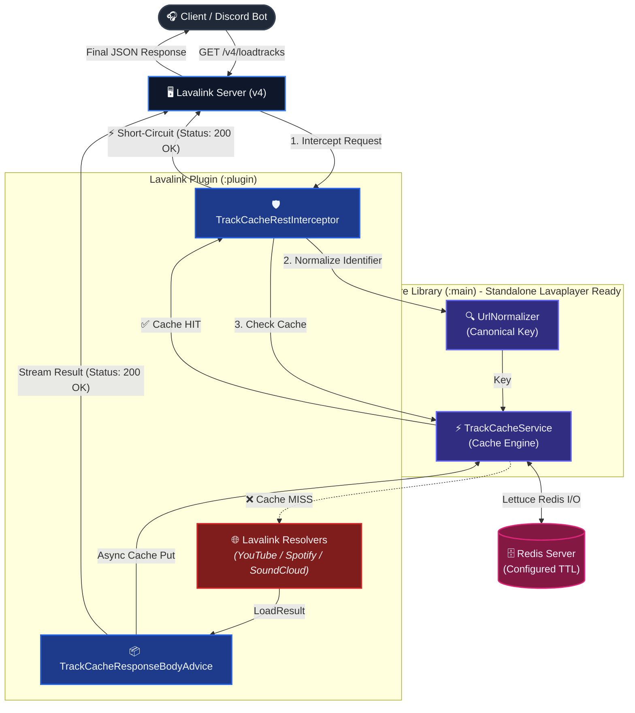

# 🎵 TrackCache - Lavalink v4 Plugin

**TrackCache** is a high-performance metadata caching plugin for **Lavalink v4**. It caches audio track and playlist metadata resolved from the `/v4/loadtracks` endpoint into a **Redis Server** using the non-blocking, thread-safe **Lettuce Client**.

By intercepting requests before they reach external audio providers (YouTube, Spotify, SoundCloud), TrackCache reduces search latency to sub-milliseconds and avoids redundant API lookups, effectively mitigating **HTTP 429 Rate Limit** issues.

---

## 🚀 Architecture & Request Flow



### Why TrackCache is Faster and Safer:
1. **Short-Circuiting Request Pipeline:** On a **Cache HIT**, `TrackCacheRestInterceptor` immediately writes the cached JSON response to the HTTP client and terminates further pipeline execution. External source managers (e.g., YouTube/Spotify) are never queried, consuming zero external network quota.
2. **Circuit Breaker Resilience:** If the Redis server becomes unavailable or times out, the plugin fails gracefully without breaking Lavalink. Incoming requests fall through directly to standard Lavaplayer loaders, accompanied by warning logs.

---

## 🔑 URL Normalization & Key Formatting

Users and bots often pass URLs with varying domains, tracking parameters, or timestamp queries. The `UrlNormalizer` standardizes queries into **Canonical Keys** prior to cache lookups:

| Source / Type | Input Query / URL Example | Canonical Key in Redis |
| :--- | :--- | :--- |
| **YouTube (Watch URL)** | `https://www.youtube.com/watch?v=dQw4w9WgXcQ&si=xyz&feature=share` | `youtube:track:dQw4w9WgXcQ` |
| **YouTube (Shortlink)** | `https://youtu.be/dQw4w9WgXcQ?si=abc123` | `youtube:track:dQw4w9WgXcQ` |
| **YouTube Mobile** | `https://m.youtube.com/watch?v=dQw4w9WgXcQ&t=45s` | `youtube:track:dQw4w9WgXcQ` |
| **YouTube Playlist** | `https://www.youtube.com/watch?v=dQw4w9WgXcQ&list=PLrAl54-B8Hk5R&si=abc` | `youtube:playlist:PLrAl54-B8Hk5R` |
| **Spotify Track** | `https://open.spotify.com/track/4cOdK2wGLETKBW3PvgPWqT?si=abc` | `spotify:track:4cOdK2wGLETKBW3PvgPWqT` |
| **Spotify Playlist** | `https://open.spotify.com/playlist/37i9dQZF1DXcBWIGoYBM5M?si=xyz` | `spotify:playlist:37i9dQZF1DXcBWIGoYBM5M` |
| **SoundCloud Track** | `https://soundcloud.com/artist/song/?si=123&utm_source=clipboard/` | `soundcloud:track:artist/song` |
| **SoundCloud Playlist** | `https://soundcloud.com/artist/sets/album/?si=123` | `soundcloud:playlist:artist/sets/album` |
| **YouTube Search** | `ytsearch:   rick   astley   never   gonna  give you up  ` | `youtube:search:rick astley never gonna give you up` |
| **SoundCloud Search** | `scsearch:   lofi   chill   beats  ` | `soundcloud:search:lofi chill beats` |
| **Spotify Search** | `spsearch:   taylor   swift  ` | `spotify:search:taylor swift` |
| **Deezer Search** | `dzsearch:   alan   walker  ` | `deezer:search:alan walker` |
| **JioSaavn Search** | `jssearch:   arijit   singh  ` | `jiosaavn:search:arijit singh` |

---

## 📦 Complete Playlist Management

When a client queries a playlist (such as YouTube Playlist or Spotify Playlist):
1. **Full Playlist Caching:** The complete playlist structure (`playlistInfo` + all `tracks`) is stored under the playlist's canonical key (e.g., `youtube:playlist:<LIST_ID>`).
2. **Automatic Track Decomposition (Pre-warming):** Each individual track contained within the playlist is extracted and stored under its own individual canonical key (e.g., `youtube:track:<VIDEO_ID>` or `spotify:track:<TRACK_ID>`). Subsequent single-track playback requests for any song from that playlist result in an **instant Cache HIT**.

---

## ⚙️ Configuration (`application.yml`)

Add the following block to your Lavalink `application.yml`:

```yaml
server:
  port: 2333
  address: 0.0.0.0

lavalink:
  server:
    password: "youshallnotpass"
    sources:
      youtube: true
      bandcamp: true
      soundcloud: true
      twitch: true
      vimeo: true
      http: true
      local: false
    bufferDurationMs: 400
  plugins:
    - dependency: "com.github.petergamez.trackcache:trackcache-plugin:1.0.0"
      repository: "https://jitpack.io" # Or place the .jar file directly into the plugins/ directory

plugins:
  trackcache:
    enabled: true               # Enable or disable plugin (default: true)

    rest-api:
      enabled: true             # Enable or disable /v4/trackcache REST endpoints (default: true)
      password: ""              # Optional: Password for REST API via X-TrackCache-Password header (disabled if empty)

    redis:
      host: "localhost"
      port: 6379
      password: ""              # Redis server password (if required)
      database: 0
      ssl: false
      key-prefix: "trackcache:" # Redis key prefix
      ttl:
        enabled: true           # Enable or disable TTL expiration (false = persistent cache, never expires)
        track-hours: 72         # TTL for individual tracks in hours (default: 72 = 3 days)
        playlist-hours: 24      # TTL for full playlists in hours (default: 24 = 1 day)
        search-hours: 2         # TTL for search queries in hours (default: 2 hours)

    cache-playlists: true                   # Cache full playlist responses
    cache-individual-playlist-tracks: true  # Decompose and cache individual tracks from playlists
    cache-searches: true                    # Cache search query results
    cache-individual-search-tracks: true    # Decompose and cache individual tracks from search results
    cache-empty: false                      # Do not cache empty/404 results
```

### 🔧 Configuration Options Breakdown

| Setting | Type | Default | Description |
| :--- | :--- | :--- | :--- |
| `enabled` | Boolean | `true` | Enables or disables the entire TrackCache caching system. |
| `rest-api.enabled` | Boolean | `true` | Enables or disables admin & monitoring REST endpoints under `/v4/trackcache/...`. |
| `rest-api.password` | String | `""` | Optional password for TrackCache REST API (`X-TrackCache-Password: <password>`). Ignored if empty. |
| `redis.host` | String | `"localhost"` | Redis server hostname or IP address. |
| `redis.port` | Integer | `6379` | Redis server port. |
| `redis.password` | String | `""` | Redis authentication password (leave empty if none). |
| `redis.database` | Integer | `0` | Redis database index (0-15). |
| `redis.ssl` | Boolean | `false` | Enables SSL/TLS encryption for Redis connections (e.g. AWS ElastiCache / Redis Cloud). |
| `redis.key-prefix` | String | `"trackcache:"` | Namespace prefix prepended to all Redis keys to avoid collisions with other apps. |
| `redis.ttl.enabled` | Boolean | `true` | Enables or disables TTL expiration (`false` = persistent cache, entries never expire). |
| `redis.ttl.track-hours` | Long | `72` | Cache expiration duration for individual tracks in hours (default: 72 = 3 days). |
| `redis.ttl.playlist-hours` | Long | `24` | Cache expiration duration for full playlist payloads in hours (default: 24 = 1 day). |
| `redis.ttl.search-hours` | Long | `2` | Cache expiration duration for search query results in hours (default: 2 hours). |
| `cache-playlists` | Boolean | `true` | Caches the full playlist payload (`loadType: playlist`) under the playlist's canonical key. |
| `cache-individual-playlist-tracks` | Boolean | `true` | Decomposes tracks within a playlist and pre-warms cache for each individual track. |
| `cache-searches` | Boolean | `true` | Caches search queries (e.g., `ytsearch:...`, `scsearch:...`). |
| `cache-individual-search-tracks` | Boolean | `true` | Decomposes tracks within search results and pre-warms cache for each individual track. |
| `cache-empty` | Boolean | `false` | Caches `loadType: empty` (404/not found) responses. Keep `false` to avoid caching transient failures. |

#### 💡 Deep Dive: How the Caching Flags Differ

1. **`redis.key-prefix` (Redis Key Namespacing)**
   - Prepends a namespace string to every key stored in Redis (e.g., `trackcache:youtube:track:dQw4w9WgXcQ`).
   - Prevents key collisions when sharing a Redis instance with other services and allows easy batch inspection or purging via `redis-cli --scan --pattern 'trackcache:*'`.

2. **`cache-playlists` vs. `cache-individual-playlist-tracks` (Bulk vs. Pre-warming)**
   - **`cache-playlists: true`:** Caches the entire playlist response as a single composite object under `trackcache:youtube:playlist:<id>`. When users re-request the exact same playlist URL, it resolves instantly in `< 1ms`.
   - **`cache-individual-playlist-tracks: true`:** Decomposes every track inside that playlist and independently caches each one under `trackcache:youtube:track:<track_id>`. If any user later requests an individual song that happened to be in that playlist, it results in an instant **Cache HIT** without querying external providers.

3. **`cache-empty` (Not Found / 404 Caching)**
   - **`false` (Recommended):** Avoids caching unavailable, deleted, or mistyped identifiers. If a track becomes available later or the user fixes a typo, Lavalink will retry cleanly.
   - **`true`:** Caches empty responses. Useful in high-traffic environments to prevent DoS attacks or repeated lookup bursts on non-existent identifiers.

4. **`cache-searches` (Search Query Caching)**
   - **`true` (Recommended):** Caches search queries like `ytsearch:faded alan walker` or `spsearch:bad guy`. Repeated queries for popular track names return cached results immediately.
   - **`false`:** Bypasses cache for search prefixes, ensuring users always receive live search rankings directly from source providers.

---

## 📊 Monitoring & Admin REST Endpoints

TrackCache provides administrative and monitoring endpoints under `/v4/trackcache/...`:

> [!NOTE]
> **Authentication:** If `rest-api.password` is configured in `application.yml`, include the `X-TrackCache-Password` header:
> `X-TrackCache-Password: <your-rest-api-password>`. If `rest-api.password` is empty (default), authentication is disabled.

### 1. View Cache Statistics
```http
GET /v4/trackcache/stats
X-TrackCache-Password: my-secret-rest-api-password
```
**Example Response:**
```json
{
  "enabled": true,
  "redisHealthy": true,
  "hits": 1420,
  "misses": 312,
  "puts": 348,
  "errors": 0,
  "hitRatioPercent": 82.0,
  "ttlEnabled": true,
  "ttlTrackHours": 72,
  "ttlSearchHours": 2,
  "ttlPlaylistHours": 24,
  "keyPrefix": "trackcache:",
  "totalCachedKeys": 1560
}
```

### 2. Inspect Canonical Key & Cache Status
```http
GET /v4/trackcache/resolve?identifier=https://www.youtube.com/watch?v=dQw4w9WgXcQ&si=123
```
**Example Response:**
```json
{
  "identifier": "https://www.youtube.com/watch?v=dQw4w9WgXcQ&si=123",
  "canonicalKey": "youtube:track:dQw4w9WgXcQ",
  "cached": true,
  "cachedData": "{\"loadType\":\"track\",...}"
}
```

### 3. Clear Cache
- **Clear a specific track or query:**
  ```http
  POST /v4/trackcache/clear?identifier=https://youtu.be/dQw4w9WgXcQ
  ```
- **Clear all cached keys:**
  ```http
  POST /v4/trackcache/clear
  ```

---