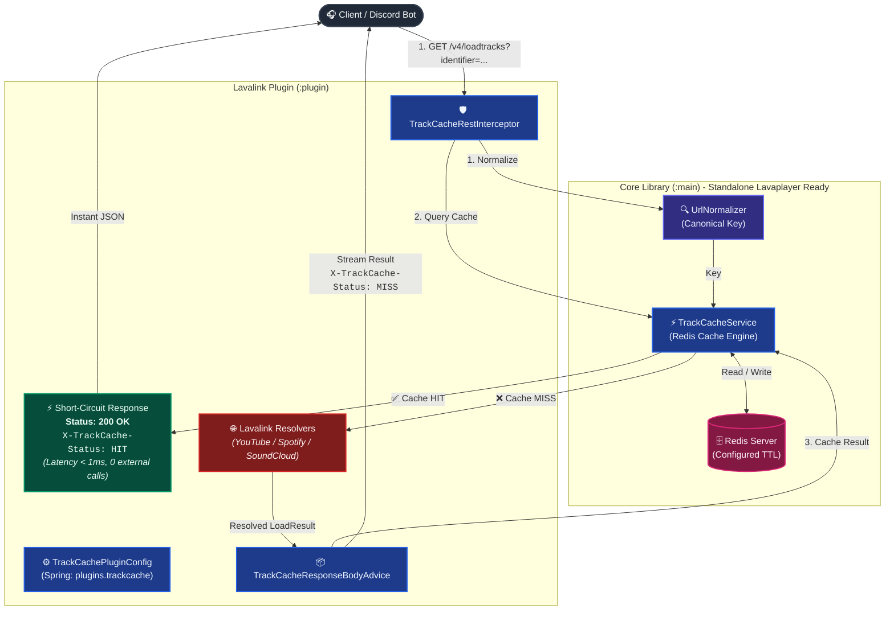

# 🎵 TrackCache - Lavalink v4 Plugin

**TrackCache** is a high-performance metadata caching plugin for **Lavalink v4**. It caches audio track and playlist metadata resolved from the `/v4/loadtracks` endpoint into a **Redis Server** using the non-blocking, thread-safe **Lettuce Client**.

By intercepting requests before they reach external audio providers (YouTube, Spotify, SoundCloud), TrackCache reduces search latency to sub-milliseconds and avoids redundant API lookups, effectively mitigating **HTTP 429 Rate Limit** issues.

---

## 🚀 Architecture & Request Flow



### Why TrackCache is Faster and Safer:
1. **Short-Circuiting Request Pipeline:** On a **Cache HIT**, `TrackCacheRestInterceptor` immediately writes the cached JSON response to the HTTP client and terminates further pipeline execution. External source managers (e.g., YouTube/Spotify) are never queried, consuming zero external network quota.
2. **Circuit Breaker Resilience:** If the Redis server becomes unavailable or times out, the plugin fails gracefully without breaking Lavalink. Incoming requests fall through directly to standard Lavaplayer loaders, accompanied by warning logs.

---

## 🔑 URL Normalization & Key Formatting

Users and bots often pass URLs with varying domains, tracking parameters, or timestamp queries. The `UrlNormalizer` standardizes queries into **Canonical Keys** prior to cache lookups:

| Source / Type | Input Query / URL Example | Canonical Key in Redis |
| :--- | :--- | :--- |
| **YouTube (Watch URL)** | `https://www.youtube.com/watch?v=dQw4w9WgXcQ&si=xyz&feature=share` | `youtube:track:dQw4w9WgXcQ` |
| **YouTube (Shortlink)** | `https://youtu.be/dQw4w9WgXcQ?si=abc123` | `youtube:track:dQw4w9WgXcQ` |
| **YouTube Shorts** | `https://youtube.com/shorts/dQw4w9WgXcQ?feature=share` | `youtube:track:dQw4w9WgXcQ` |
| **YouTube Mobile** | `https://m.youtube.com/watch?v=dQw4w9WgXcQ&t=45s` | `youtube:track:dQw4w9WgXcQ` |
| **YouTube Playlist** | `https://www.youtube.com/watch?v=dQw4w9WgXcQ&list=PLrAl54-B8Hk5R&si=abc` | `youtube:playlist:PLrAl54-B8Hk5R` |
| **Spotify Track** | `https://open.spotify.com/track/4cOdK2wGLETKBW3PvgPWqT?si=abc` | `spotify:track:4cOdK2wGLETKBW3PvgPWqT` |
| **Spotify Playlist** | `https://open.spotify.com/playlist/37i9dQZF1DXcBWIGoYBM5M?si=xyz` | `spotify:playlist:37i9dQZF1DXcBWIGoYBM5M` |
| **SoundCloud Track** | `https://soundcloud.com/artist/song/?si=123&utm_source=clipboard/` | `soundcloud:track:artist/song` |
| **SoundCloud Playlist** | `https://soundcloud.com/artist/sets/album/?si=123` | `soundcloud:playlist:artist/sets/album` |
| **YouTube Search** | `ytsearch:   rick   astley   never   gonna  give you up  ` | `youtube:search:rick astley never gonna give you up` |
| **SoundCloud Search** | `scsearch:   lofi   chill   beats  ` | `soundcloud:search:lofi chill beats` |
| **Spotify Search** | `spsearch:   taylor   swift  ` | `spotify:search:taylor swift` |
| **Deezer Search** | `dzsearch:   alan   walker  ` | `deezer:search:alan walker` |
| **JioSaavn Search** | `jssearch:   arijit   singh  ` | `jiosaavn:search:arijit singh` |

---

## 📦 Complete Playlist Management

When a client queries a playlist (such as YouTube Playlist or Spotify Playlist):
1. **Full Playlist Caching:** The complete playlist structure (`playlistInfo` + all `tracks`) is stored under the playlist's canonical key (e.g., `youtube:playlist:<LIST_ID>`).
2. **Automatic Track Decomposition (Pre-warming):** Each individual track contained within the playlist is extracted and stored under its own individual canonical key (e.g., `youtube:track:<VIDEO_ID>` or `spotify:track:<TRACK_ID>`). Subsequent single-track playback requests for any song from that playlist result in an **instant Cache HIT**.

---

## ⚙️ Configuration (`application.yml`)

Add the following block to your Lavalink `application.yml`:

```yaml
lavalink:
  plugins:
    - dependency: "com.github.petergamez.trackcache:trackcache-plugin:1.0.0"
      repository: "https://jitpack.io" # Or place the .jar file directly into the plugins/ directory

plugins:
  trackcache:
    enabled: true
    rest-api: true                     # Enable or disable /v4/trackcache REST endpoints (default: true)
    host: "localhost"
    port: 6379
    password: ""
    database: 0
    ssl: false
    ttl-minutes: 1440                  # Cache duration in minutes (default: 24 hours)
    key-prefix: "lavalink:trackcache:"   # Redis key prefix
    cache-playlists: true              # Cache full playlist responses
    cache-individual-playlist-tracks: true # Decompose and cache individual tracks from playlists
    cache-empty: false                 # Do not cache empty/404 results
    cache-searches: true               # Cache search query results
```

---

## 📊 Monitoring & Admin REST Endpoints

TrackCache provides administrative and monitoring endpoints under `/v4/trackcache/...`:

### 1. View Cache Statistics
```http
GET /v4/trackcache/stats
```
**Example Response:**
```json
{
  "enabled": true,
  "redisHealthy": true,
  "hits": 1420,
  "misses": 312,
  "puts": 348,
  "errors": 0,
  "hitRatioPercent": 82.0,
  "ttlMinutes": 1440,
  "keyPrefix": "lavalink:trackcache:",
  "totalCachedKeys": 1560
}
```

### 2. Inspect Canonical Key & Cache Status
```http
GET /v4/trackcache/resolve?identifier=https://www.youtube.com/watch?v=dQw4w9WgXcQ&si=123
```
**Example Response:**
```json
{
  "identifier": "https://www.youtube.com/watch?v=dQw4w9WgXcQ&si=123",
  "canonicalKey": "youtube:track:dQw4w9WgXcQ",
  "cached": true,
  "cachedData": "{\"loadType\":\"track\",...}"
}
```

### 3. Clear Cache
- **Clear a specific track or query:**
  ```http
  POST /v4/trackcache/clear?identifier=https://youtu.be/dQw4w9WgXcQ
  ```
- **Clear all cached keys:**
  ```http
  POST /v4/trackcache/clear
  ```

---

## 🏷️ CI/CD Auto-versioning from Git Tags

Modeled after `lavalink-devs/youtube-source`:
- Uses `org.ajoberstar.grgit` in `build.gradle.kts` to dynamically calculate the project version from the current Git state.
- When building on a tagged commit (e.g., `git tag -a 1.0.0`), the build automatically marks it as a release version.
- When building on untagged or dirty commits, `-SNAPSHOT` is automatically appended.
- The GitHub Actions workflow (`.github/workflows/publish.yml`) automatically builds and publishes the release artifact when a Git tag is pushed.

---

## 🛠️ Building

To build the plugin JAR locally:

```bash
./gradlew build
```

The resulting JAR will be generated in:
```text
build/libs/trackcache-plugin-<version>.jar
```